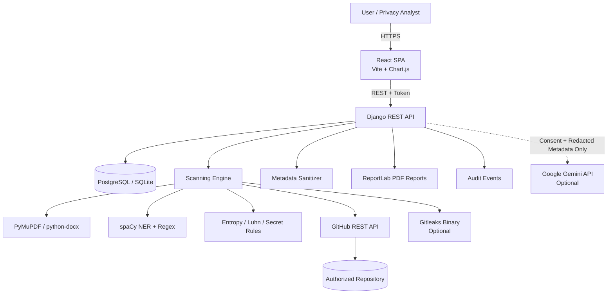
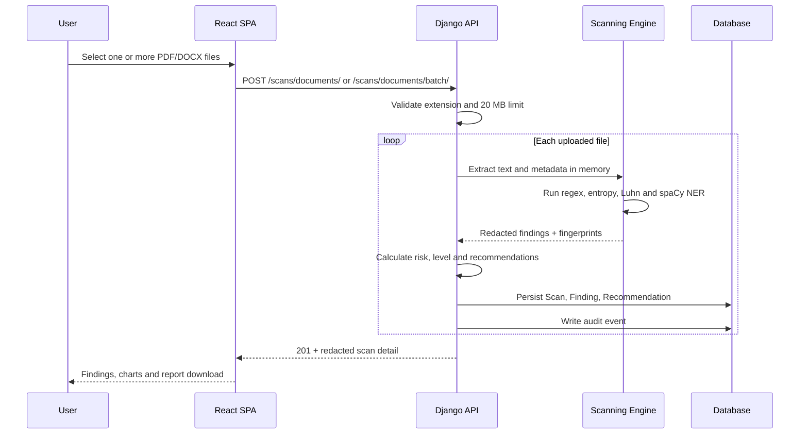
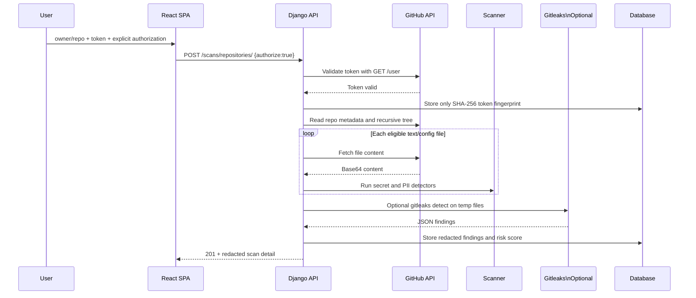
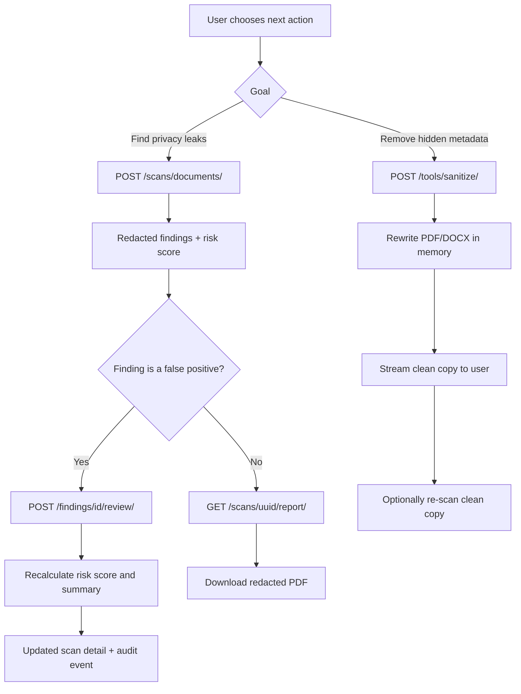
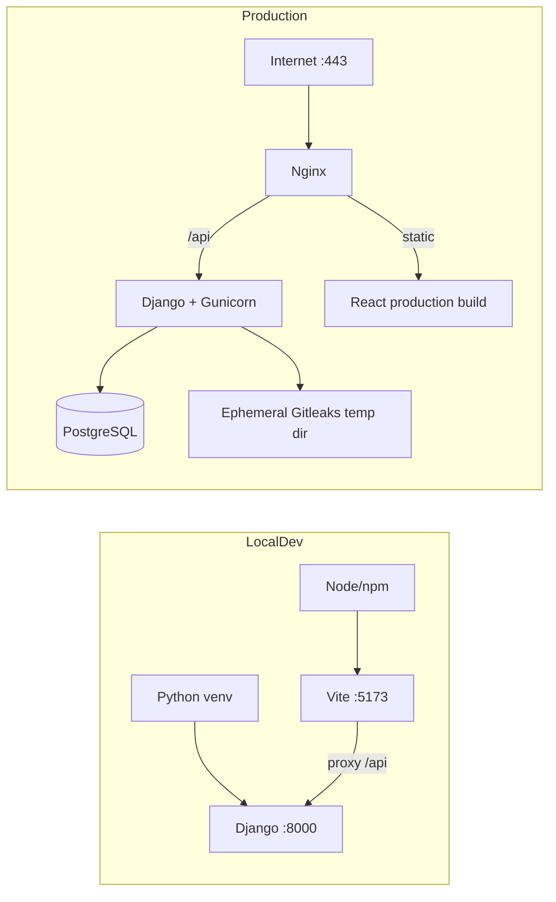

# ZeroTrace — AI-Powered Privacy Leak Detection & Digital Footprint Analyzer

ZeroTrace is a full-stack privacy protection platform that identifies sensitive information exposure in user-provided PDF/DOCX documents and explicitly authorized GitHub repositories. It uses real scanning engines (PyMuPDF, python-docx, spaCy NER, regex/entropy/Luhn rules, GitHub REST API and optional Gitleaks), calculates a weighted privacy risk score, and produces redacted PDF reports with prioritized remediation guidance.

**Last updated:** 23/11/2026<br>
**License holder:** N.J.Bala Mani kantan

> Uploaded documents are processed in memory, never persisted, and never sent to an external AI service unless the user explicitly opts in. Detected secrets are never stored or returned in clear text.

## Contents

- [Key capabilities](#key-capabilities)
- [How it works: workflow diagrams](#how-it-works-workflow-diagrams)
- [Privacy and security model](#privacy-and-security-model)
- [Technology stack](#technology-stack)
- [Project structure](#project-structure)
- [Installation](#installation)
- [Command reference](#command-reference)
- [Configuration](#configuration)
- [API overview](#api-overview)
- [Testing](#testing)
- [Troubleshooting](#troubleshooting)
- [Documentation](#documentation)
- [License](#license)

## Key capabilities

1. **Authentication and user management** — Django custom user, token auth, registration, login, logout and explicit AI consent state.
2. **PDF/DOCX privacy scanner** — extracts text with PyMuPDF/python-docx and analyses author, last-modified-by, custom and XMP metadata.
3. **Personal information detection** — spaCy named-entity recognition (PERSON, GPE/LOC) with a regex fallback when the model is unavailable.
4. **Credential exposure detection** — detects AWS keys, GitHub tokens, Google API keys, Slack tokens, Stripe keys, JWTs, private-key blocks, password assignments, connection strings and high-entropy values.
5. **Authorized GitHub repository scanning** — validates a supplied token, requires an explicit `authorize: true` flag, enumerates text/config files through the GitHub REST API and scans them with the same engines.
6. **Optional Gitleaks integration** — runs the real `gitleaks detect` binary against temporarily downloaded authorized repository files when installed; otherwise the API reports that Gitleaks is unavailable and regex/entropy scanning still runs.
7. **AI privacy risk assessment** — deterministic severity-weighted scoring plus optional Google Gemini narrative that receives only redacted finding metadata after opt-in.
8. **Recommendation engine** — generates prioritized remediation steps based on detected categories.
9. **Interactive analytics dashboard** — Chart.js doughnut/bar/line charts, KPI cards, scan activity, privacy improvement trend and a risk-score timeline.
10. **Redacted PDF reports** — ReportLab-generated reports containing redacted evidence, fingerprints, risk assessment and remediation plan.
11. **Batch document scanning** — Upload up to 10 PDF/DOCX files in one request and receive separate risk-scored results.
12. **Metadata sanitizer** — Generate a real clean copy of a PDF/DOCX with author, custom properties, XMP metadata and embedded attachments removed.
13. **False-positive review** — Dismiss findings with one click; scan risk score and severity distribution recalculate immediately.
14. **Audit trail and risk timeline** — Privacy-safe activity log plus a 12-point risk-score trend chart on the dashboard.

## How it works: workflow diagrams

### System flowchart



### Document scan sequence



### Repository scan sequence



### Sanitizer and false-positive review workflow



### Local and production deployment flow



## Privacy and security model

| Control | Implementation |
| --- | --- |
| No repository scanning without authorization | `authorize: true` is mandatory; token is validated before scanning; only `owner/repo` supplied by the user is accessed. |
| No raw secret exposure | Findings store `redacted_evidence`, `redacted_context` and a SHA-256 fingerprint only. |
| No unnecessary personal data storage | Uploaded files are never written to disk; scan metadata stores presence/keys, not raw metadata values. |
| No document content sent to external AI | Gemini receives only category, severity, title, location and redacted evidence, and only when `ai_consent` is true. |
| No token persistence | GitHub tokens are used in memory; only a SHA-256 `token_fingerprint` is stored. |
| Redacted reports | PDF report generation uses only redacted fields and a sanitized source label. |
| Tenant isolation | Every scan/finding/recommendation query is filtered by the authenticated user. |
| Privacy-safe audit events | Audit metadata contains counts, booleans and statuses only — never raw text, secrets or tokens. |

## Technology stack

| Layer | Technology |
| --- | --- |
| Frontend | React 18, Vite, React Router, Chart.js, custom CSS (no Bootstrap) |
| Backend | Python 3.12, Django 5.1, Django REST Framework, Token Auth |
| Database | PostgreSQL (production/docker), SQLite fallback for local dev |
| NLP | spaCy `en_core_web_sm`, regex, Shannon entropy, Luhn validation |
| Documents | PyMuPDF, python-docx |
| Secret scanning | Custom detectors + optional Gitleaks binary |
| Reporting | ReportLab |
| AI | Google Gemini API (optional, consent-gated) |
| Diagrams | Mermaid (GitHub-rendered) |

## Project structure

```text
Zero-Trace/
├── zero-trace/
│   ├── backend/
│   │   ├── apps/
│   │   │   ├── accounts/          # Custom user + consent
│   │   │   ├── api/               # Serializers, views, URLs, tests
│   │   │   ├── engine/            # Scanners, sanitizer, reports, tests
│   │   │   └── scans/             # Models, audit helper, migrations
│   │   ├── zerotrace/             # Settings, URLs, WSGI/ASGI
│   │   ├── media/                 # Git-kept empty media directory
│   │   ├── .env.example
│   │   ├── manage.py
│   │   └── requirements.txt
│   ├── frontend/
│   │   ├── src/
│   │   │   ├── components/        # Layout, charts, UI primitives, icons
│   │   │   ├── context/           # Auth context
│   │   │   ├── pages/             # Dashboard, scanners, tools, audit, settings
│   │   │   ├── services/          # Axios API client
│   │   │   └── styles/            # Custom CSS
│   │   ├── .env.example
│   │   ├── index.html
│   │   ├── package.json
│   │   └── vite.config.js
│   ├── deployment/                # Docker Compose, Dockerfiles, nginx.conf
│   ├── docs/                      # API, architecture, ER diagram, deployment
│   ├── .gitignore
│   ├── LICENSE
│   ├── README.md
│   └── start-dev.ps1
├── LICENSE
└── README.md
```

## Installation

### Prerequisites

| Requirement | Version / notes |
| --- | --- |
| Python | 3.12 or newer |
| Node.js | 18+ recommended; 20+ also supported |
| npm | Bundled with Node.js |
| PostgreSQL | Optional; SQLite is used when `DATABASE_URL` is empty |
| Git | For cloning the repository |
| Gitleaks | Optional; enables real secret scanning for authorized repositories |

### Windows PowerShell — local development

```powershell
git clone https://github.com/Njbalamani/Zero-Trace.git
cd Zero-Trace\zero-trace

cd backend
py -3.12 -m venv .venv
.\.venv\Scripts\python.exe -m pip install --upgrade pip
.\.venv\Scripts\python.exe -m pip install -r requirements.txt
.\.venv\Scripts\python.exe -m spacy download en_core_web_sm
Copy-Item .env.example .env
.\.venv\Scripts\python.exe manage.py migrate
.\.venv\Scripts\python.exe manage.py createsuperuser
.\.venv\Scripts\python.exe manage.py runserver 0.0.0.0:8000
```

Open a second PowerShell window for the frontend:

```powershell
cd Zero-Trace\zero-trace\frontend
npm install
Copy-Item .env.example .env
npm run dev
```

Open `http://localhost:5173`. The Vite dev server proxies `/api` to `http://127.0.0.1:8000`.

To launch both servers in separate windows after installing dependencies:

```powershell
cd Zero-Trace\zero-trace
.\start-dev.ps1
```

### macOS / Linux — local development

```bash
git clone https://github.com/Njbalamani/Zero-Trace.git
cd Zero-Trace/zero-trace/backend

python3.12 -m venv .venv
source .venv/bin/activate
python -m pip install --upgrade pip
python -m pip install -r requirements.txt
python -m spacy download en_core_web_sm
cp .env.example .env
python manage.py migrate
python manage.py createsuperuser
python manage.py runserver 0.0.0.0:8000
```

In a second terminal:

```bash
cd Zero-Trace/zero-trace/frontend
npm install
cp .env.example .env
npm run dev
```

### Docker deployment

Windows PowerShell:

```powershell
cd Zero-Trace\zero-trace
Copy-Item backend\.env.example backend\.env
docker compose -f deployment/docker-compose.yml up --build
```

macOS / Linux:

```bash
cd Zero-Trace/zero-trace
cp backend/.env.example backend/.env
docker compose -f deployment/docker-compose.yml up --build
```

Services: PostgreSQL, Django/Gunicorn backend on port 8000, nginx-served React build on port 3000.

### Verify the installation

```powershell
curl.exe http://127.0.0.1:8000/api/health/
curl.exe -I http://127.0.0.1:5173
```

Expected health response includes `"status": "ok"` and detector availability.

## Command reference

### Backend commands

Run these from `zero-trace/backend` using the virtual-environment Python.

| Command | Purpose |
| --- | --- |
| `python manage.py check` | Validate Django configuration without touching the database |
| `python manage.py makemigrations` | Generate migrations after model changes |
| `python manage.py migrate` | Apply migrations to the configured database |
| `python manage.py createsuperuser` | Create an admin account |
| `python manage.py runserver 0.0.0.0:8000` | Start the development API server |
| `python manage.py test apps --verbosity 2` | Run all backend tests with detail |
| `python -m spacy download en_core_web_sm` | Install the NLP model used by `nlp_detector.py` |
| `python manage.py collectstatic --noinput` | Collect static files for production |

On Windows, replace `python` with `.\\.venv\\Scripts\\python.exe`.

### Frontend commands

Run these from `zero-trace/frontend`.

| Command | Purpose |
| --- | --- |
| `npm install` | Install dependencies from `package-lock.json` |
| `npm run dev` | Start Vite development server on port 5173 |
| `npm run build` | Build production assets into `dist/` |
| `npm run preview` | Preview the production build locally |

If PowerShell blocks `npm.ps1`, use `npm.cmd install`, `npm.cmd run dev`, etc., or run `Set-ExecutionPolicy -Scope Process -ExecutionPolicy Bypass`.

### Docker commands

Run these from `zero-trace`.

| Command | Purpose |
| --- | --- |
| `docker compose -f deployment/docker-compose.yml up --build` | Build images and start all services |
| `docker compose -f deployment/docker-compose.yml logs -f backend` | Follow backend logs |
| `docker compose -f deployment/docker-compose.yml ps` | Show service status |
| `docker compose -f deployment/docker-compose.yml exec backend python manage.py migrate` | Apply migrations inside the backend container |
| `docker compose -f deployment/docker-compose.yml down` | Stop and remove containers |

### API command examples

Register:

```powershell
curl.exe -X POST http://127.0.0.1:8000/api/auth/register/ `
  -H "Content-Type: application/json" `
  -d "{\"username\":\"analyst\",\"email\":\"analyst@example.com\",\"password\":\"Str0ng!Passphrase42\"}"
```

Login and store the token:

```powershell
$response = Invoke-RestMethod -Uri http://127.0.0.1:8000/api/auth/login/ -Method Post `
  -ContentType "application/json" `
  -Body '{"email":"analyst@example.com","password":"Str0ng!Passphrase42"}'
$TOKEN = $response.token
```

Scan one document:

```powershell
curl.exe -X POST http://127.0.0.1:8000/api/scans/documents/ `
  -H "Authorization: Token $TOKEN" `
  -F "file=@C:\reports\quarterly.pdf"
```

Scan multiple documents:

```powershell
curl.exe -X POST http://127.0.0.1:8000/api/scans/documents/batch/ `
  -H "Authorization: Token $TOKEN" `
  -F "files=@C:\reports\quarterly.pdf" `
  -F "files=@C:\reports\brief.docx"
```

Create a metadata-clean copy:

```powershell
curl.exe -X POST http://127.0.0.1:8000/api/tools/sanitize/ `
  -H "Authorization: Token $TOKEN" `
  -F "file=@C:\reports\quarterly.pdf" `
  -o quarterly-clean.pdf
```

Scan an authorized repository:

```powershell
curl.exe -X POST http://127.0.0.1:8000/api/scans/repositories/ `
  -H "Authorization: Token $TOKEN" `
  -H "Content-Type: application/json" `
  -d "{\"repository\":\"acme/app\",\"token\":\"ghp_placeholder\",\"authorize\":true}"
```

Mark a finding as a false positive:

```powershell
curl.exe -X POST http://127.0.0.1:8000/api/findings/12/review/ `
  -H "Authorization: Token $TOKEN" `
  -H "Content-Type: application/json" `
  -d "{\"false_positive\":true}"
```

Download a redacted report and read the audit trail:

```powershell
curl.exe -X GET http://127.0.0.1:8000/api/scans/SCAN_UUID/report/ `
  -H "Authorization: Token $TOKEN" -o zerotrace-report.pdf

curl.exe -X GET http://127.0.0.1:8000/api/audit/ `
  -H "Authorization: Token $TOKEN"
```

## Configuration

Create `backend/.env`:

```env
SECRET_KEY=replace-with-a-long-random-value
DEBUG=false
ALLOWED_HOSTS=localhost,127.0.0.1,your-domain.com
CORS_ALLOWED_ORIGINS=http://localhost:5173,http://127.0.0.1:5173
DATABASE_URL=
DB_SSLMODE=prefer
GEMINI_API_KEY=
GEMINI_MODEL=gemini-1.5-flash
GITLEAKS_BINARY=gitleaks
GITLEAKS_TIMEOUT=120
GITHUB_TIMEOUT=30
MAX_REPO_FILES=400
MAX_REPO_FILE_BYTES=512000
SPACY_MODEL=en_core_web_sm
```

For Docker/PostgreSQL, set:

```env
DATABASE_URL=postgresql://zerotrace:zerotrace@db:5432/zerotrace
DB_SSLMODE=prefer
```

`GEMINI_API_KEY` is optional; without it, the deterministic assessment engine is used even if the user has consented.

## API overview

Base URL: `/api/`

| Method | Endpoint | Description |
| --- | --- | --- |
| POST | `/auth/register/` | Create account and receive token |
| POST | `/auth/login/` | Authenticate with email/password |
| POST | `/auth/logout/` | Revoke current token |
| GET | `/auth/me/` | Current user and consent state |
| POST | `/auth/consent/` | Enable/disable external AI consent |
| POST | `/scans/documents/` | Upload PDF/DOCX and scan |
| POST | `/scans/documents/batch/` | Scan up to 10 documents in one request |
| POST | `/scans/repositories/` | Scan explicitly authorized repository |
| GET | `/scans/` | List current user's scans |
| GET | `/scans/<uuid>/` | Scan detail with redacted findings |
| GET | `/scans/<uuid>/report/` | Download redacted PDF report |
| GET | `/dashboard/` | Aggregated dashboard metrics |
| GET | `/recommendations/` | Current user's remediation guidance |
| GET | `/findings/` | Redacted findings across scans |
| POST | `/findings/<id>/review/` | Mark a finding as false positive or restore it |
| POST | `/tools/sanitize/` | Download a metadata-clean PDF/DOCX copy |
| GET | `/audit/` | Privacy-safe account activity log |
| GET | `/health/` | Service and detector status |

Full request/response documentation is in [docs/API.md](docs/API.md).

## Testing

```powershell
cd backend
.\.venv\Scripts\python.exe manage.py check
.\.venv\Scripts\python.exe manage.py test apps --verbosity 2

cd ..\frontend
npm run build
```

The suite covers auth/consent flows, document and batch upload, redaction, metadata sanitization, false-positive review, audit logging, PDF report generation, tenant isolation, authorized repository scanning, token fingerprinting, dashboard aggregation, detector rules, Luhn validation and risk scoring.

## Troubleshooting

| Problem | Fix |
| --- | --- |
| `npm.ps1 cannot be loaded` in PowerShell | Use `npm.cmd`, or run `Set-ExecutionPolicy -Scope Process -ExecutionPolicy Bypass` |
| `spaCy model not found` | Run `python -m spacy download en_core_web_sm` inside the venv |
| Gitleaks shown as unavailable | Install Gitleaks and add it to `PATH`, or set `GITLEAKS_BINARY`; regex/entropy scanning still works |
| Port 8000 or 5173 already in use | Stop the conflicting service or use `manage.py runserver 0.0.0.0:8001` / `npm run dev -- --port 5174` |
| `curl` behaves differently in PowerShell | Use `curl.exe` to call the real executable instead of the PowerShell alias |
| Migration database is locked | Stop running servers, then rerun `manage.py migrate` |
| Frontend cannot reach API | Confirm backend is on port 8000 and `frontend/.env` has `VITE_API_URL=/api` |

## Documentation

- [REST API documentation](docs/API.md)
- [Architecture and data-flow diagrams](docs/ARCHITECTURE.md)
- [Database ER diagram](docs/ER_DIAGRAM.md)
- [Deployment guide](docs/DEPLOYMENT.md)

## License

MIT © 2026 N.J.Bala Mani kantan — see [LICENSE](LICENSE).
