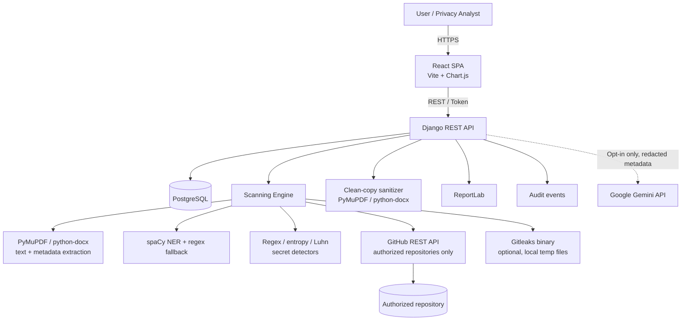
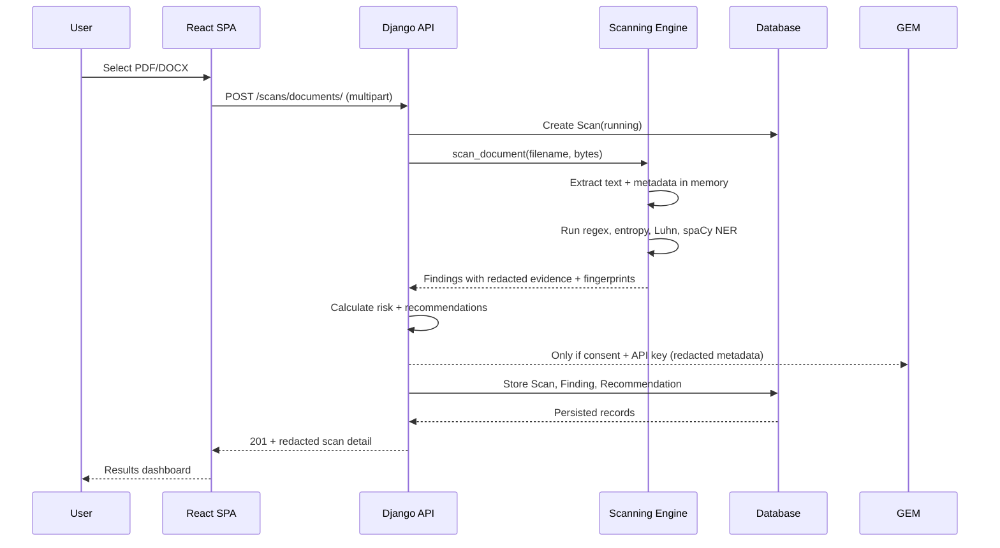
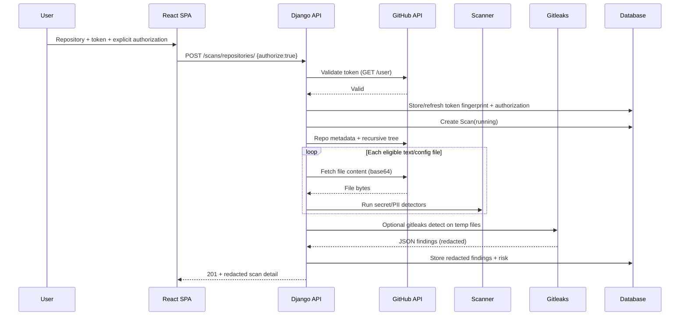
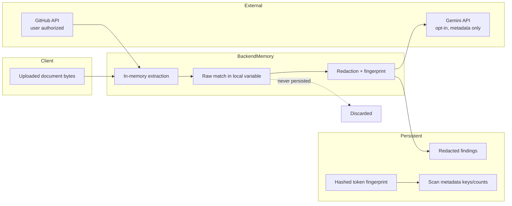
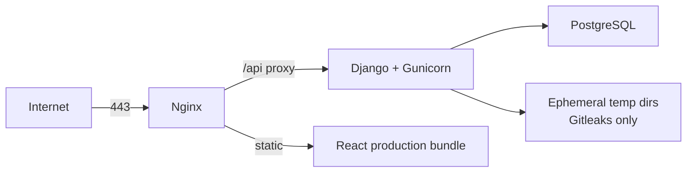

# ZeroTrace Architecture

## System overview

## Request flow: document scan

## Expansion flows

- **Batch scan:** the API accepts repeated `files` parts, validates each upload, then reuses the same in-memory `scan_document()` engine per file. Successful and failed items are returned separately, and each successful item creates its own `Scan`, `Finding` and `Recommendation` records.
- **Sanitizer:** `apps/engine/sanitizer.py` rewrites PDF/DOCX bytes in memory, clears metadata dictionaries and streams the clean copy directly to the client. No sanitized or original file is persisted.
- **False-positive review:** `POST /findings/<id>/review/` toggles `Finding.false_positive`, recalculates `Scan.risk_score`, `risk_level` and `summary`, writes an audit event and returns full updated scan detail.
- **Audit and timeline:** `apps/scans/audit.py` writes small structured events for login, consent, scans, sanitization and reviews. Dashboard `risk_timeline` is derived from completed scans and feeds the React risk chart.

## Request flow: repository scan

## Privacy boundaries

## Components

| Component | Responsibility |
| --- | --- |
| `apps/accounts` | Custom user model, AI consent flag, token authentication |
| `apps/api` | REST serializers, views, routes, integration tests |
| `apps/scans` | Scan, Finding, Recommendation, RepositoryAuthorization and AuditEvent models; `audit.py` event helper |
| `apps/engine/document_scanner.py` | Orchestrates in-memory PDF/DOCX processing |
| `apps/engine/metadata_analyzer.py` | PyMuPDF/python-docx metadata and XMP/custom property inspection |
| `apps/engine/text_detector.py` | Emails, phones, secrets, financial identifiers, confidential markers |
| `apps/engine/nlp_detector.py` | spaCy NER with regex fallback |
| `apps/engine/github_scanner.py` | Authorized GitHub REST scanning |
| `apps/engine/gitleaks_runner.py` | Local Gitleaks subprocess wrapper |
| `apps/engine/risk_engine.py` | Scoring, recommendations, consent-gated AI narrative |
| `apps/engine/report_generator.py` | Redacted PDF report |
| `apps/engine/sanitizer.py` | Real PDF/DOCX metadata and attachment cleanup |
| `frontend/src` | React SPA with dashboard, scanners, batch scans, privacy tools, history, detail, audit trail and settings |

## Deployment topology

See [DEPLOYMENT.md](DEPLOYMENT.md) for configuration details and [ER_DIAGRAM.md](ER_DIAGRAM.md) for the database schema.
