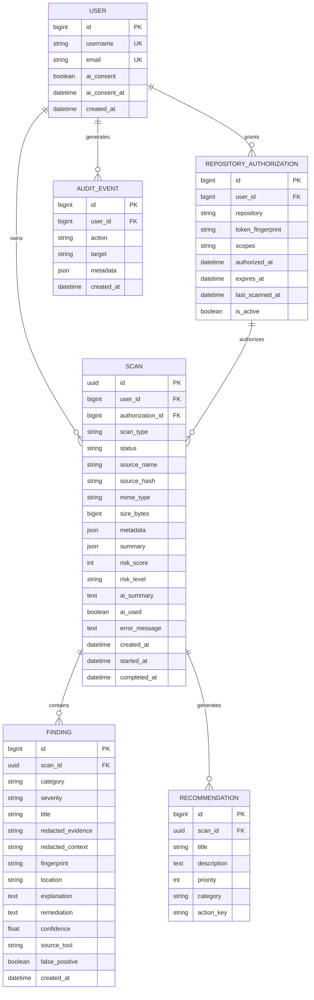

# Database ER Diagram

## Constraints and privacy notes

- `USER.email` and `USER.username` are unique; authentication uses `email`.
- `REPOSITORY_AUTHORIZATION(user_id, repository)` is unique. The token itself is never stored; `token_fingerprint` is SHA-256 of the supplied token.
- `FINDING(scan_id, fingerprint)` is unique, preventing duplicate detections per scan.
- `FINDING.redacted_evidence`/`redacted_context` contain placeholders only. The raw matched value is never persisted.
- `SCAN.source_name` is sanitized before persistence (emails and phone-like sequences are replaced with placeholders).
- `SCAN.metadata` stores counts, field names and engine status rather than raw document metadata values.
- `AUDIT_EVENT.metadata` stores counts, booleans and status values only; raw text, detected secrets and tokens are never written to the audit log.
- PostgreSQL is used in production; a SQLite fallback exists for local development only.
